# 📱 Awesome Mobile App Testing 🚀

> A curated collection of top commercial mobile app testing platforms, open-source automation frameworks, self-hosted device farms, and modern E2E testing toolchains for iOS & Android.

  
  
  
  
  
  

🌟 *Star this repository to stay updated on the latest mobile QA, testing frameworks, and device cloud innovations!* 🌟

---

## 📑 Contents

- [📊 Sector Overview & Market Dynamics](#-sector-overview--market-dynamics)
- [☁️ SaaS & Hosted Device Testing Platforms](#️-saas--hosted-device-testing-platforms)
- [🛠️ Open-Source Testing Frameworks & Tools](#️-open-source-testing-frameworks--tools)
- [🏢 Open-Source Device Farms & Self-Hosted Labs](#-open-source-device-farms--self-hosted-labs)
- [🍎 Native First-Party Testing Toolchains](#-native-first-party-testing-toolchains)
- [🤝 Contributing](#-contributing)
- [📜 License](#-license)

---

## 📊 Sector Overview & Market Dynamics

The global mobile application testing market is valued at approximately **$9 billion to $11.5 billion** and is projected to expand to **$19 billion–$35 billion** over the next decade at a compound annual growth rate (CAGR) of **16%–17%**. The sector is **moderately fragmented** rather than winner-take-all: while hyperscalers (AWS, Google) and specialized cloud testing leaders (BrowserStack, Sauce Labs) command substantial market share, rapid proliferation of Android hardware variants, iOS device updates, and open-source frameworks (Appium, Maestro) creates sustained demand for agile niche players, on-premise device labs, and specialized test automation ecosystems.

---

## ☁️ SaaS & Hosted Device Testing Platforms

*Commercial cloud device farms, AI-augmented mobile execution engines, and hosted cross-platform automation suites.*

The table below summarizes leading SaaS mobile application testing platforms, sorted in descending order by parent company scale (valuation or annual revenue):

| Platform | Company Valuation / Revenue | Starting Price (Paid Tier) | Free Tier / Trial Limit | Key Capabilities & Highlights |
| :--- | :--- | :--- | :--- | :--- |
| **AWS Device Farm** | Parent: Amazon Web Services ($100B+ ARR / $2T+ Cap) | **$0.17/device-minute** (unmetered slots: $250/device/mo) | **One-time 1,000 free device minutes** trial across real devices | Fully managed real-device testing for iOS, Android, and web apps with native Appium/Espresso runners. |
| **Firebase Test Lab** | Parent: Alphabet / Google ($350B+ Rev / $2T+ Cap) | **$0.10/virtual device min; $1.00/physical device min** (Blaze pay-as-you-go) | **Free Spark plan: 10 virtual tests/day + 5 physical tests/day** forever | Direct integration with Google Cloud & Firebase CI/CD; automated Robo tests and physical Android/iOS pools. |
| **Perfecto Mobile** | Parent: Perforce Software (Clearlake Capital / ~$4B+ Valuation) | **$300/mo** (billed annually for entry automated concurrent plan) | **14-day free trial** with access to live manual testing & test analytics | Enterprise-grade device cloud with stringent compliance, biometric simulation, audio injection, and AI reporting. |
| **BrowserStack** | **$4 Billion Valuation** (~$150M+ ARR) | **$29/user/month** (annual Live) / **$199/mo** (Automation) | **100 free automation minutes & 30 min interactive live testing** trial | Massive real-device grid spanning 3,000+ iOS/Android devices and browsers with out-of-the-box CI/CD support. |
| **Sauce Labs** | **$750M+ Valuation** ($272M+ total raised) | **$39/month** (annual Live) / **$199/mo** (Real Device Cloud) | **28-day free trial** with 60 automated/live minutes and 3 parallel virtual machines | High-concurrency cross-platform orchestration, root cause error analysis, and mobile error telemetry. |
| **LambdaTest** | **$400M Valuation** (Series D, ~$40M+ ARR) | **$15/user/month** (annual Live) / **$79/month** (HyperExecute/Automation) | **Free forever plan: 60 live test mins/mo (10 min/session)** + 1 concurrent session | High-speed HyperExecute grid, KaneAI autonomous authoring, real Android/iOS physical device cloud. |
| **BitBar** | SmartBear portfolio ($300M+ ARR / $2.5B+ Valuation) | **$39/month** (annual Live) / **$177/month** (annual Automated) | **14-day free trial** with access to real Android/iOS devices | Unlimited manual and automated concurrency options on real hardware; deep integrations with Swagger and TestComplete. |
| **HeadSpin** | ~$200M+ Valuation (Series C / $100M+ raised) | **$39/month** (annual CloudTest Lite) / **$83/month** (CloudTest Go) | **14-day free trial** with cloud device access upon demo activation | AI-driven QoE (Quality of Experience), audio/video playback testing, and packet-level network performance tracking. |
| **Kobiton** | ~$80M–$100M Valuation (~$27M ARR) | **$83/month** (billed annually for 1 device concurrent slot) | **14-day free trial** with limited real-device session credits | Hybrid cloud flexibility: deploy tests across Kobiton's real public device cloud or on-premises local hardware. |
| **TestGrid** | Early-stage growth / $15M+ Valuation ($1.5M+ Seed) | **$25/user/month** (Live) / **$199/user/month** (Automation & Co-host) | **Free forever plan: 200 minutes/month** of real-device testing | No-code scriptless AI testing, IoT device support, co-hosted plug-and-play local physical device farms. |

---

## 🛠️ Open-Source Testing Frameworks & Tools

*Open-source mobile test runners, E2E test drivers, and debugging utilities. Sorted descending by GitHub star count.*

| Framework / Tool | GitHub Stars | Primary Platform | Description |
| :--- | :--- | :--- | :--- |
| **[scrcpy](https://github.com/Genymobile/scrcpy)** |  | Android | Display and control physical Android devices over USB/TCP without root; low latency, lightweight utility essential for mobile QA labs. |
| **[Appium](https://github.com/appium/appium)** |  | iOS / Android / Web | The global de facto open-source standard for cross-platform mobile automation. Powered by the W3C WebDriver specification. |
| **[Maestro](https://github.com/mobile-dev-inc/maestro)** |  | iOS / Android / RN / Flutter | Painless, declarative YAML-driven E2E UI automation built for developer velocity, automated retries, and zero-flakiness test runs. |
| **[Detox](https://github.com/wix/Detox)** |  | React Native / iOS / Android | Gray-box end-to-end testing and automation library designed by Wix; synchronizes automatically with native event loops and network calls. |
| **[Airtest](https://github.com/AirtestProject/Airtest)** |  | iOS / Android / Games | Cross-platform UI automation framework utilizing image recognition and OpenCV to test games, native apps, and dynamic interfaces. |
| **[idb (iOS Development Bridge)](https://github.com/facebook/idb)** |  | iOS | Meta's flexible command-line and gRPC interface for automating, inspecting, and manipulating iOS simulators and physical iPhones. |
| **[Macaca](https://github.com/alibaba/macaca)** |  | iOS / Android / Hybrid | Alibaba's multi-platform open-source automation solution supporting native, hybrid, and mobile web app continuous integration. |
| **[Kaspresso](https://github.com/KasperskyLab/Kaspresso)** |  | Android | Modern Android UI testing framework based on Espresso and Kakao with built-in flaky test protection, screenshotting, and ADB orchestration. |
| **[Calabash Android](https://github.com/calabash/calabash-android)** |  | Android | Automated Cucumber-based BDD acceptance testing framework for Android apps. |
| **[Android Test Support Library](https://github.com/android/android-test)** |  | Android | Official Google open-source repository containing test runners, rules, and Espresso testing extensions. |
| **[Selendroid](https://github.com/selendroid/selendroid)** |  | Android | Selenium-based test automation framework targeting Android native and hybrid applications. |
| **[Mobly](https://github.com/google/mobly)** |  | Android / Multi-Device | Google's Python-based test framework designed for complex multi-device end-to-end integration testing (Wi-Fi handoffs, Bluetooth, and cellular). |
| **[Marathon](https://github.com/MarathonLabs/marathon)** |  | Android / iOS | Ultra-fast cross-platform test runner and execution engine with smart test batching, test sharding, and automatic flakiness management. |
| **[Appium Flutter Driver](https://github.com/appium/appium-flutter-driver)** |  | Flutter (iOS & Android) | Official Appium test automation driver specialized for Flutter mobile applications using the Flutter Driver extension. |
| **[Robot Framework AppiumLibrary](https://github.com/serhatbolsu/robotframework-appiumlibrary)** |  | iOS / Android | Keyword-driven mobile application testing library for Robot Framework integrating with Appium. |
| **[AppiumFW](https://github.com/badrusalam11/appiumfw)** |  | Android / iOS | Lightweight Page Object Model (POM) Python framework with CLI scaffolding for Appium mobile automation projects. |

---

## 🏢 Open-Source Device Farms & Self-Hosted Labs

*Build, run, and scale private on-premise mobile device testing infrastructure without third-party vendor lock-in. Sorted descending by GitHub star count.*

| Project | GitHub Stars | Supported Devices | Highlights & Architecture |
| :--- | :--- | :--- | :--- |
| **[OpenSTF (Smartphone Test Farm)](https://github.com/openstf/stf)** |  | Android | Legendary browser-based mobile device farm controlling physical Android devices remotely with smooth touchscreen streaming and ADB access. |
| **[DeviceFarmer / STF](https://github.com/DeviceFarmer/stf)** |  | Android | Actively maintained community fork of OpenSTF with continuous modern Android OS compatibility and security updates. |
| **[Sonic Cloud Server](https://github.com/SonicCloudOrg/sonic-server)** |  | iOS / Android | Distributed open-source continuous mobile device cloud platform supporting real Android & iOS devices with remote inspection and CI execution. |
| **[tapflow](https://github.com/jo-duchan/tapflow)** |  | iOS Simulators & Android Emulators | Lightweight self-hosted alternative to BrowserStack/Appetize; streams virtual devices via browser WebRTC using bare-metal Apple Silicon / PC hardware. |
| **[Appium Device Farm](https://github.com/AppiumTestDistribution/appium-device-farm)** |  | iOS & Android | Official Appium 2.0 plugin designed to manage and schedule test execution across connected local or distributed mobile devices. |
| **[GADS (Go Android Device Server)](https://github.com/shamanec/GADS)** |  | Android & iOS | High-performance Go-based device farm providing real-time device streaming, Appium orchestration, and remote test harness controls. |

---

## 🍎 Native First-Party Testing Toolchains

*Vendor-supplied official developer frameworks for native platform QA and deterministic unit/UI testing.*

* **[Espresso](https://developer.android.com/training/testing/espresso)** – Google’s first-party UI testing framework for Android apps. Runs directly within the app process to ensure lightning-fast execution and synchronized UI thread state checks.
* **[XCUITest](https://developer.apple.com/documentation/xctest)** – Apple’s official native UI testing framework integrated directly with Xcode and Swift. Provides full access to native iOS, iPadOS, watchOS, and tvOS accessibility hierarchies and system dialogs.
* **[UI Automator](https://developer.android.com/training/testing/other-components/ui-automator)** – Google’s testing framework for cross-app functional UI testing across system dialogues, notifications, and third-party apps on Android.

---

## 🤝 Contributing

Contributions are warmly welcomed! Help keep this awesome list comprehensive, accurate, and up to date.

1. 🍴 Fork the repository.
2. 🌿 Create a feature branch: `git checkout -b feature/new-mobile-testing-tool`.
3. 📝 Add your open-source tool, device farm, or SaaS platform with accurate specs and star badge.
4. 🚀 Commit your changes: `git commit -m "Add <Tool-Name> to mobile testing list"`.
5. 🔀 Open a pull request against `main`.

---

## 📜 License

Distributed under the MIT License. See [LICENSE](LICENSE) for more information.
